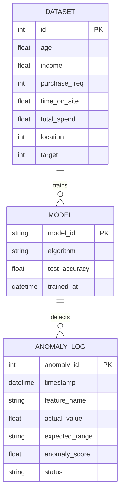
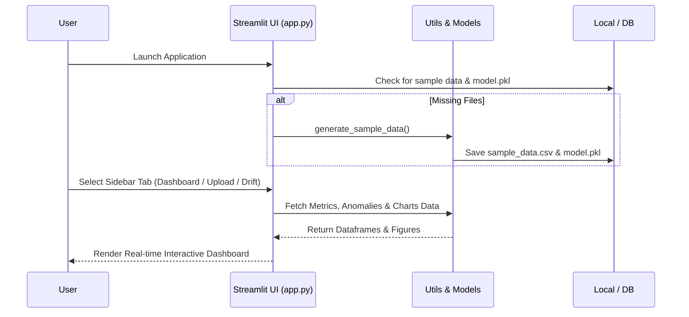

# 📈 ML Model Health Monitor

[](https://github.com/alok-kumar8765)
[](https://www.python.org/)
[](https://streamlit.io/)
[](https://scikit-learn.org/)
[](https://opensource.org/licenses/MIT)

---

## 📝 Description
**ML Model Health Monitor** is an advanced, real-time MLOps web application designed to track, evaluate, and monitor machine learning production models. Built using **Streamlit**, **Plotly**, and **Scikit-Learn**, it provides instant visibility into classification performance, data distribution shifts, feature importance ratings, and real-time anomaly alerts.

---

## 📑 Table of Contents
1. [File Structure](#-file-structure)
2. [Architecture & Diagrams](#-architecture--diagrams)
   - [Entity-Relationship (ER) Diagram](#1-entity-relationship-er-diagram)
   - [Data Flow Diagram (DFD)](#2-data-flow-diagram-dfd)
   - [System Flow Diagram](#3-system-flow-diagram)
3. [Requirements](#-requirements)
4. [Setup Guide & Installation](#-setup-guide--installation)
5. [Use of Project & Use Cases](#-use-of-project--use-cases)
6. [Pros, Cons & Limitations](#-pros-cons--limitations)
7. [Known Bugs & Vulnerabilities](#-known-bugs--vulnerabilities)
8. [Future Upgrades Roadmap](#-future-upgrades-roadmap)
9. [Contributing](#-contributing)
10. [Acknowledgments & Thanks](#-acknowledgments--thanks)

---

## 📂 File Structure

```text
ML_MODEL_HEALTH_MONITOR/
│
├── data/
│   └── sample_data.csv        # Baseline dataset for training & testing (50+ rows)
├── models/
│   └── model.pkl              # Serialized production machine learning model
├── app.py                     # Main Streamlit application and dashboard UI
├── utils.py                   # Helper functions for data loading and ML utilities
└── requirements.txt           # Project Python dependencies
```

---

## 📊 Architecture & Diagrams

### 1. Entity-Relationship (ER) Diagram


### 2. Data Flow Diagram (DFD)
```mermaid
flowchart TD
    subgraph Data Sources
        A1[CSV / Excel Upload]
        A2[MySQL Production DB]
    end

    subgraph Core Engine (utils.py & app.py)
        B[Data Validation & Preprocessing]
        C[RandomForest Model Inference]
        D[Drift & Anomaly Detection Algorithm]
    end

    subgraph User Interface (Streamlit)
        E[KPI Metrics & Trend Cards]
        F[Interactive Plotly Charts]
        G[Recent Anomalies Table]
        H[Downloadable Reports]
    end

    A1 --> B
    A2 --> B
    B --> C
    C --> D
    D --> E
    D --> F
    D --> G
    D --> H
```

### 3. System Flow Diagram


---

## 📦 Requirements

The project requires **Python 3.10+**. Ensure the following packages are installed via `requirements.txt`:

```text
streamlit==1.37.0
pandas==2.2.2
numpy==1.26.4
plotly==5.22.0
scikit-learn==1.5.1
joblib==1.4.2
openpyxl==3.1.5
```

---

## ⚙️ Setup Guide & Installation

Follow these steps to set up and run the project locally:

1. **Clone the Repository:**
   ```bash
   git clone https://github.com/alok-kumar8765/ML_Model_Health_Monitor.git
   cd ML_Model_Health_Monitor
   ```

2. **Create and Activate a Virtual Environment:**
   ```bash
   python -m venv venv
   # On Windows:
   venv\Scripts\activate
   # On macOS/Linux:
   source venv/bin/activate
   ```

3. **Install Dependencies:**
   ```bash
   pip install -r requirements.txt
   ```

4. **Verify Directory Structure:**
   Ensure your local project matches the [File Structure](#-file-structure) format. The application automatically builds baseline test files if none are found.

5. **Run the Streamlit Application:**
   ```bash
   streamlit run app.py
   ```

6. **Open in Browser:**
   Navigate to `http://localhost:8501` to view your running application dashboard.

---

## 🎯 Use of Project & Use Cases

### Target Audience
* **ML Engineers & MLOps Teams:** Continuously monitor production data drift, distribution changes, and model degradation.
* **Data Scientists:** Rapidly test feature importance, inspect classification evaluation reports, and deploy baseline classifiers.
* **Engineering Leadership:** Review production model health via real-time KPIs and structured anomaly audit reports.

### Key Use Cases
1. **Real-time Health Auditing:** Review multi-month trends for accuracy, precision, and recall.
2. **Data Drift Tracking:** Evaluate Population Stability Index (PSI) and feature density shifts against baseline datasets.
3. **Dynamic Model Retraining:** Upload new CSV/Excel datasets via the sidebar to instantly train and serialize updated model instances.
4. **Audit Logging:** Download real-time anomaly matrices as structured CSV files for downstream processing or compliance.

---

## ⚖️ Pros, Cons & Limitations

### Pros
* **Lightweight & Modular:** Clean separation of concerns between layout (`app.py`), backend logic (`utils.py`), and storage files.
* **Interactive UI:** Leverages native Streamlit components and Plotly graphics for high-responsiveness.
* **Zero Configuration Start:** Automatic fallback generation ensures the app functions immediately out-of-the-box.

### Cons / Limitations
* **Local Storage Persistence:** Relies on local file structures (`models/model.pkl`) rather than an external centralized model registry (e.g., MLflow) by default.
* **Single-Node Processing:** Scaled for standard tabular data applications; massive enterprise streams require distributed data aggregation layers.

---

## 🐛 Known Bugs & Vulnerabilities

* **Target Class Ratio Warning:** If training datasets contain small row sizes where unique classes exceed 50% of total rows, Scikit-Learn emits standard training `UserWarning` notifications (handled gracefully via app data checks).
* **Database Connection Credentials:** Sidebar MySQL inputs serve as structured UI placeholders; ensure environment credentials (`os.environ`) are securely configured prior to production integration.

---

## 🚀 Future Upgrades Roadmap

- [ ] **MLflow / Wandb Registry Integration:** Centralize versioning and experiment telemetry tracking.
- [ ] **Advanced Statistical Drift Metrics:** Expand PSI and Wasserstein distance metrics.
- [ ] **Automated Alerting Webhooks:** Implement Slack/Discord/Email notifications upon threshold breaches.
- [ ] **Role-Based Access Control (RBAC):** Restrict configuration modifications and retraining permissions to authorized personnel.

---

## 🤝 Contributing

Contributions, feature additions, and bug fixes are welcome! 
1. Fork the Project (`https://github.com/alok-kumar8765/ML_Model_Health_Monitor`)
2. Create your Feature Branch (`git checkout -b feature/AmazingFeature`)
3. Commit your Changes (`git commit -m 'Add some AmazingFeature'`)
4. Push to the Branch (`git push origin feature/AmazingFeature`)
5. Open a Pull Request

---

## 🙏 Acknowledgments & Thanks

* **Streamlit Community** for seamless UI development frameworks.
* **Scikit-Learn & Plotly Contributors** for powerful machine learning utilities and visualizations.
* Developed by **[alok-kumar8765](https://github.com/alok-kumar8765)**.